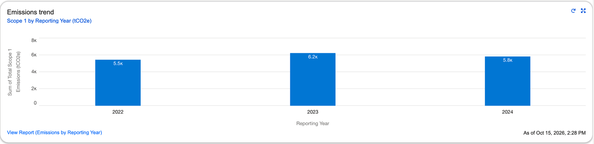
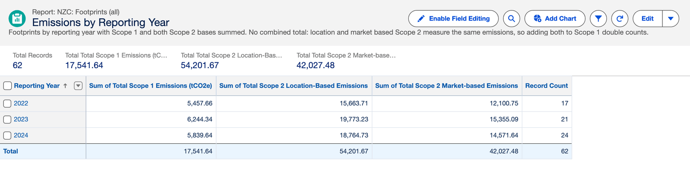
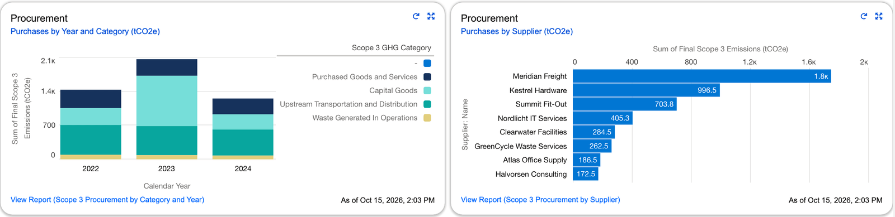
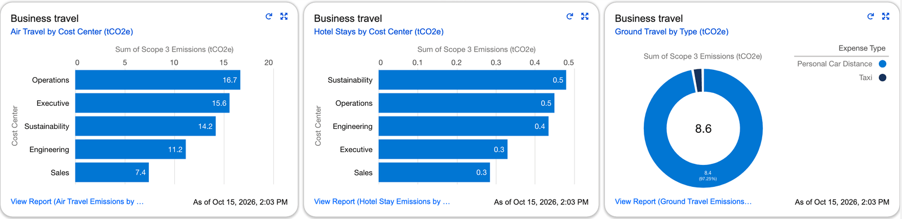
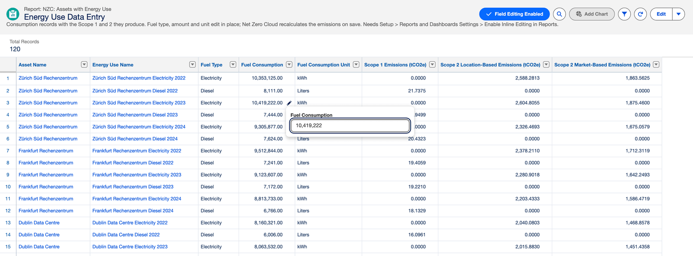
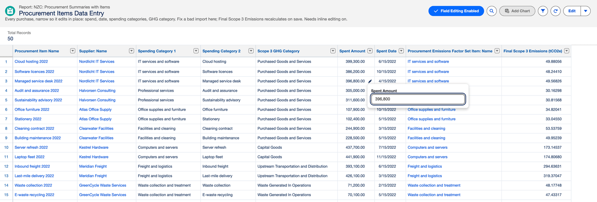
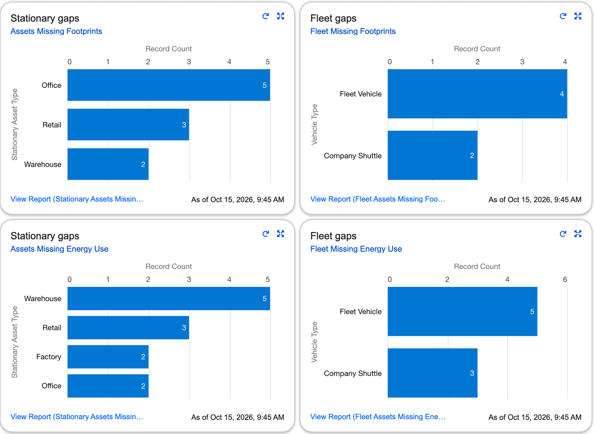

# nzc-customreports

[](https://github.com/mshresponse/nzc-customreports/actions/workflows/validate.yml)
[](LICENSE)

**22 custom report types, 32 reports, 4 dashboards and 6 list views for Salesforce Net Zero
Cloud** (now sold as Agentforce Net Zero), using core Lightning reporting only. No CRM
Analytics, no Einstein, no managed package, no custom objects or fields. API 67.0.

On the name: the product launched as Sustainability Cloud, became Net Zero Cloud in 2022 and
Agentforce Net Zero in 2025. Everything here is labelled `NZC:` because that is what the
object API names, the Setup menu and the developer guide still say — and because a report
type's API name can't be renamed in place, only deleted and recreated in every org that has it.

The reports are laid out for **inline editing**, so a sustainability team can correct data
in the report instead of raising a ticket for a CSV re-upload.

## What it looks like

Captured in a Net Zero Cloud scratch org loaded with [`sample-data/showcase`](sample-data/README.md).
Every site, supplier and figure is fictional.

**Scope 1 and 2.** Total Scope 1 by reporting year on the *NZC Emissions Coverage* dashboard,
and the *Emissions by Reporting Year* report with both Scope 2 bases beside it, never added
together.




**Scope 3.** Purchases by year, GHG category and supplier, and business travel by cost centre
and type, on the *NZC Scope 3* dashboard.




**Inline editing.** Correct an energy use or a purchase in the report itself; Net Zero Cloud
recalculates its Scope 1, 2 or 3 on save.




**Data quality.** Sites and vehicles with no footprint or no energy use; each chart opens the
worklist behind it.



---

## Setup — 4 steps

**1. Check your org has Net Zero Cloud.**
Setup → Object Manager. You need to see `StnryAssetEnvrSrc`, `StnryAssetCrbnFtprnt`,
`StnryAssetEnrgyUse`, `VehicleAssetEmssnSrc`, `VehicleAssetCrbnFtprnt` and
`VehicleAssetEnrgyUse`, and for the Scope 3 reports `Scope3CrbnFtprnt`, `Scope3PcmtItem` and
`AirTravelEnrgyUse` among others. A free Developer Edition org and a standard Trailhead Playground
do **not** have these — see [Orgs that work](#orgs-that-work).

**2. Deploy.**

```bash
sf project deploy start --manifest manifest/package.xml --target-org <alias>
```

Or one click, no CLI:

<a href="https://githubsfdeploy.herokuapp.com/app/githubdeploy/mshresponse/nzc-customreports?ref=main">
  
</a>

**3. Enable inline editing.**
Setup → **Reports and Dashboards Settings** → tick **Enable Inline Editing in Reports** → Save.

Off by default in most orgs. Without it the reports still run, but read-only.

**4. Share the two folders.**
Reports tab → All Folders → *NZC Reports* → **Share**. Same for *NZC Dashboards*.

Deployed folders are private to whoever deployed them. Give the sustainability team
**Editor** on the report folder.

That's the whole setup. Nothing else to configure, no permission sets, no post-install
script.

---

## What you get

**5 reports you edit directly** — tabular, narrow, every column editable in place:

| Report | Fix in place |
|---|---|
| Asset Names and Locations | Site names, city, country, asset type |
| Fleet Names and Types | Vehicle names and types |
| Footprint Data Entry | Reporting year, stage |
| Energy Use Data Entry | Fuel type, consumption, unit |
| Fleet Energy Data Entry | Fuel type, consumption, distance |

The Scope 1 and Scope 2 totals on a footprint are not on that list, and can't be: Net Zero
Cloud calculates them from the energy use records and emission factors, and the fields are
read-only even for an admin. Correct the energy use and the footprint follows.

**4 reports that find missing records** — a cross filter (*assets **without** footprints*),
grouped by asset type:

Stationary Assets Missing Footprints · Stationary Assets Missing Energy Use ·
Fleet Assets Missing Footprints · Fleet Assets Missing Energy Use

**4 reports that find orphans** — child records whose parent lookup is blank, which a join
can never show you:

Orphaned Carbon Footprints · Orphaned Stationary Energy Uses · Orphaned Fleet Footprints ·
Orphaned Vehicle Energy Uses

An orphaned footprint, one with no asset, still contributes to a total. It's a number in
your disclosure that nothing explains. An orphaned energy use is the opposite problem: Net
Zero Cloud won't let one exist without its asset, but it can lose its footprint — deleting a
footprint blanks the lookup on every energy use under it — and then its consumption is
counted in no footprint at all.

**3 summaries** — Emissions by Reporting Year, Fuel Consumption by Fuel Type, Fleet Fuel by
Fuel Type. The two fuel reports group by fuel type *and* unit and have no grand total,
because kilowatt-hours, therms and liters don't add up.

**5 audit reports** — the part of the CRM Analytics audit dashboard you can rebuild in core
Lightning. Emissions by Asset and Year is a matrix, one site per row and one year per
column, so a figure that jumped or collapsed between years stands out on a single screen.
Footprints by Stage and Footprints by Year and Stage (stationary and fleet) show how much of
each disclosure year is still draft or in progress — a number that could still change under
audit.

**11 Scope 3 reports and the NZC Scope 3 dashboard** — built on the figures Net Zero Cloud
calculates on each record as it saves it: spend times factor for a purchase, distance and haul
band for a flight, nights for a hotel stay, distance for ground travel.

- Purchases by year and GHG category, by supplier, and spend against emissions by category —
  spend grouped by currency, never added across currencies.
- Air travel and hotel stays by cost center; ground travel by type, which separates business
  travel from commuting.
- Scope 3 footprints by year and stage, and Scope 3 emissions by reporting year from Net Zero
  Cloud's footprint roll-ups.
- Procurement Items Data Entry, editable in place.
- Two worklists: **Procurement Items Without a Factor** — spend that is in your procurement
  data but adds nothing to Scope 3 — and **Scope 3 Sources Missing Footprints**.

**22 report types** — 16 for stationary and fleet, in three shapes each (`with`, an inner
join; `with/without`, an outer join; and standalone), and 6 for Scope 3: procurement summaries
with their items, air, hotel and ground travel, Scope 3 sources with or without footprints,
and Scope 3 footprints. Build your own reports on any of them; that's rather the point of
shipping the source.

**4 dashboards** — NZC Audit, NZC Data Quality, NZC Emissions Coverage and NZC Scope 3. NZC Audit has a
**Reporting Year** filter across the top, so an admin can audit one disclosure year at a
time; the year list is 2023–2026 and is a one-minute edit in the dashboard builder. Every
component opens its report, and every report is editable inline where the record exists.

**6 list views**, optional, for Winter '27 bulk editing — see
[List views for bulk edits](#list-views-for-bulk-edits-winter-27).

---

## Why this doesn't come with the product

Net Zero Cloud ships **CRM Analytics dashboards**, and those need a separate licence. From
the [Net Zero Cloud Developer Guide, v67.0 Summer '26](https://developer.salesforce.com/docs/atlas.en-us.netzero_cloud_dev_guide.meta/netzero_cloud_dev_guide/netzero_cloud_std_objects_intro.htm),
page 1:

> The Net Zero Cloud Analytics dashboards are available only for Salesforce Net Zero Cloud
> users with CRM Analytics for Net Zero Cloud add-on license.

It ships **no standard Lightning report types** for the emissions objects. You can verify
that in your own org:

```bash
sf data query --use-tooling-api --target-org <alias> --query \
"SELECT QualifiedApiName, IsReportingEnabled FROM EntityDefinition \
 WHERE QualifiedApiName LIKE 'StnryAsset%' OR QualifiedApiName LIKE 'VehicleAsset%'"
```

Every NZC object returns `IsReportingEnabled = false`, which is the flag governing whether
Salesforce auto-generates standard report types. It's read-only on standard objects, so
there's nothing to switch on. A custom report type isn't a refinement here — it's the only
way to report on Net Zero Cloud data at all.

---

## Inline editing: what it can't do

The limits shaped the report layouts, so they're worth knowing before you promise anything:

| Rule | Consequence |
|---|---|
| Tabular, summary and matrix only | No joined reports. None here are joined. |
| 12 editable fields per row, 100 per report | The data-entry reports are narrow on purpose. |
| Grouping fields are not editable | Group by something you don't need to fix. |
| A lookup that's null across the row can't be edited | You can't create a missing record from a report. |
| FLS and validation rules still apply | A failing edit shows the rule's own message. |
| The field must be on the record's page layout, on the default tab | A column that's greyed out in the report is usually a field that's missing from the layout or sits on a second tab. Winter '27 lifts this for **list views only** (see below); reports still need the field on the layout. |

That fourth row is why the **Missing** reports are upload worklists, not fix-it-here
reports. If an asset has no footprint record, there's no footprint row to edit. Inline
editing fixes what exists; it doesn't conjure records.

---

<a name="list-views-for-bulk-edits-winter-27"></a>
## List views for bulk edits (Winter '27)

Winter '27 adds two **User Interface** settings (Setup → User Interface), both off by
default:

- **Make inline edits in list views with multiple record types** — a list mixing record
  types used to turn editing off entirely.
- **Remove list view inline edit dependencies on page layout** — edit any field you have
  edit access to, on the layout or not.

With both on, a list view becomes the better bulk-edit surface: edit several rows, save
once, no refresh after every cell. The package ships one list view per Net Zero Cloud
object with the same narrow columns as the data-entry reports. They're in their own
manifest so they never gate the core deploy:

```bash
sf project deploy start --manifest manifest/package-4-list-views.xml --target-org <alias> --dry-run
```

All six validate against a licensed Net Zero Cloud org. They're kept separate anyway, because
they only earn their place once those two settings are on, and because list view column
names are their own name space (see [`docs/building-your-own.md`](docs/building-your-own.md)).

---

<a name="orgs-that-work"></a>
## Orgs that work

| Org | Free? | Lasts | Notes |
|---|---|---|---|
| [NZC trial — Learning org](https://developer.salesforce.com/free-trials/comparison/net-zero-cloud) | Yes | 30 days | Pre-configured with sample data. |
| [NZC trial — Base org](https://developer.salesforce.com/free-trials/comparison/net-zero-cloud) | Yes | 30 days | Licences only. Reports deploy but return nothing until you load data — see [`sample-data/`](sample-data/). |
| [Trailhead promo DE org](https://trailhead.salesforce.com/promo/orgs/net-zero-cloud) | Yes | Check at signup | Licensed for Agentforce Net Zero. |
| Scratch org from your Dev Hub | Yes | Up to 30 days | `sf org create scratch --definition-file config/project-scratch-def.json --alias nzc`. Net Zero Cloud is switched on by the definition file; assign yourself the `NetZeroAdmin` permission set before loading data. |
| Your own licensed org or sandbox | — | — | Deploy to a sandbox first. |

Salesforce's docs list NZC as available in Enterprise, Performance, Unlimited and Developer
Editions. That describes which editions the licence *can be added to*, not what you get on
signup — which is where the afternoon goes.

## What the deploy does

- A **Metadata API deploy of source**, not a package install. Nothing appears under Setup →
  Installed Packages.
- Everything lands as **ordinary metadata you own** — editable, renameable, deletable. No
  uninstall button; delete the components.
- **All-or-nothing** (`rollbackOnError`). A failure leaves nothing behind.
- Deploying user needs **Modify Metadata Through Metadata API Functions** or **Modify All
  Data**.

## Two modelling choices worth knowing

**No combined emissions total.** NZC splits Scope 2 into `TotScope2LocBasedEmissions` and
`TotScope2MktBasedEmissions` — two accounting methods for the *same* emissions, not two
sources. Adding both to Scope 1 double counts. Emissions by Reporting Year reports the
three side by side and leaves the choice of basis to whoever owns the disclosure. Don't
substitute the `SuplScope*` fields; they measure something different, and using them
produces a report that runs cleanly and reports the wrong number.

**Fleet fuel comes from the energy use record.** `VehicleAssetEmssnSrc` has no fuel field —
fuel, consumption and distance all live on `VehicleAssetEnrgyUse`.

## Scope: the reports read the whole object, deliberately

Twenty-two of the 32 reports carry no filter — the other ten are the Missing, Orphaned and
Without a Factor worklists, which filter by definition — and all 32 leave the standard date filter
unbounded. That is a decision, not an oversight, and it is worth understanding before you
deploy into an org with years of history.

**Why unbounded.** The date column available on these objects is `CreatedDate` — when
somebody typed the record in. The business axis is `ReportingYear`, and the two do not
agree: a footprint *for* 2024 is routinely entered in 2026, during the disclosure cycle.
Bounding on `CreatedDate` would therefore drop records that belong in the answer. It would
make the reports faster and wrong, which is the worse of the two failures for anything
feeding a disclosure.

**What it costs.** Each of these reports reads every record in scope on every run. On a
dev org or a first year of data that is invisible. On an org with several years of
footprint and energy-use records it is the first thing that will get slow, and the
dashboard-fed reports pay it on every refresh.

**What to do about it, when you get there.** Add a `ReportingYear` filter — it is on every
report type here, and it is the axis the reports already group by. Which years to keep is
a question about your disclosure obligations rather than about Salesforce, which is why
this repository does not choose for you.

Two related shapes, also deliberate:

- **The six tabular reports have no row limit.** They are worklists and lookup lists —
  *Footprint Data Entry*, *Asset Names and Locations* — meant to be worked all the way
  through. A row limit on a worklist hides the rows somebody still has to fill in.
- **The summary reports show details.** The same reports are read two ways: as a chart on a
  dashboard, and as a list of the specific assets to go and fix. Turning details off would
  make the chart marginally cheaper and the worklist useless.

## Also in this repo

- [`sample-data/`](sample-data/) — UTF-8 CSVs with deliberate gaps and orphans, so the
  Missing and Orphaned reports return rows on an empty trial org. Loads in one command; the
  README there lists the rows each report should return. `sample-data/showcase/` is a
  larger fictional dataset — 34 sites, 22 vehicles, three years, plus Scope 3 procurement
  and business travel — for demos.
- [`scripts/check-reports.py`](scripts/check-reports.py) — runs every report and dashboard
  against an org holding the sample data and compares with those rows.
- [`config/project-scratch-def.json`](config/project-scratch-def.json) — a scratch org with
  Net Zero Cloud switched on.
- [`docs/encoding-evidence/`](docs/encoding-evidence/) — why accented site names arrive as
  question marks, and which step is responsible.
- [`docs/building-your-own.md`](docs/building-your-own.md) — the report type metadata
  gotchas, for anyone forking this.
- [`docs/appexchange.md`](docs/appexchange.md) — the plan for a free AgentExchange
  (AppExchange) listing, and what a managed package would change for people who install it.

## Continuous integration

`.github/workflows/validate.yml` checks XML well-formedness, that `sf project convert
source` succeeds, that every member in every `manifest/*.xml` has a matching source file, and
that `sample-data/tree/` matches the CSVs it is generated from.

**None of that can see a wrong object or field name.** A reference to an object that does
not exist produces well-formed XML that converts cleanly and matches the manifest. This
repo carried a green badge while referencing five objects that don't exist. Only a deploy
against a licensed org proves the names resolve:

```bash
sf project deploy start --manifest manifest/package.xml --target-org <alias> --dry-run
```

**And a deploy can't see a report that returns the wrong rows.** The four Missing reports
deployed cleanly for months while listing every asset, because a filter on the child side
of an outer join behaves like part of the join (see
[`docs/building-your-own.md`](docs/building-your-own.md)). So the workflow has a second
job: it creates a Net Zero Cloud scratch org, deploys, loads the sample data and runs
`scripts/check-reports.py`. It needs a Dev Hub, supplied as the repository secret
`DEVHUB_SFDX_AUTH_URL`; without it the job is skipped.

## License

MIT. Built and maintained by [Everything Virtually](https://www.everythingvirtually.com/).
